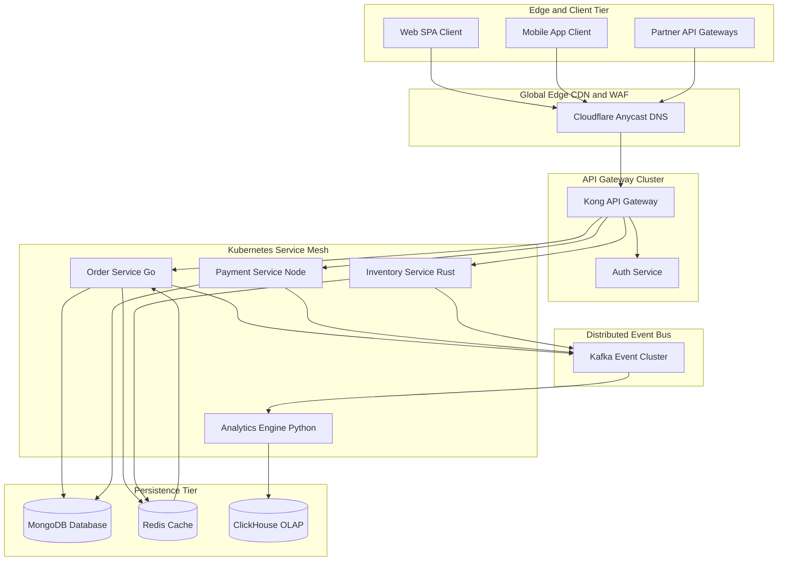
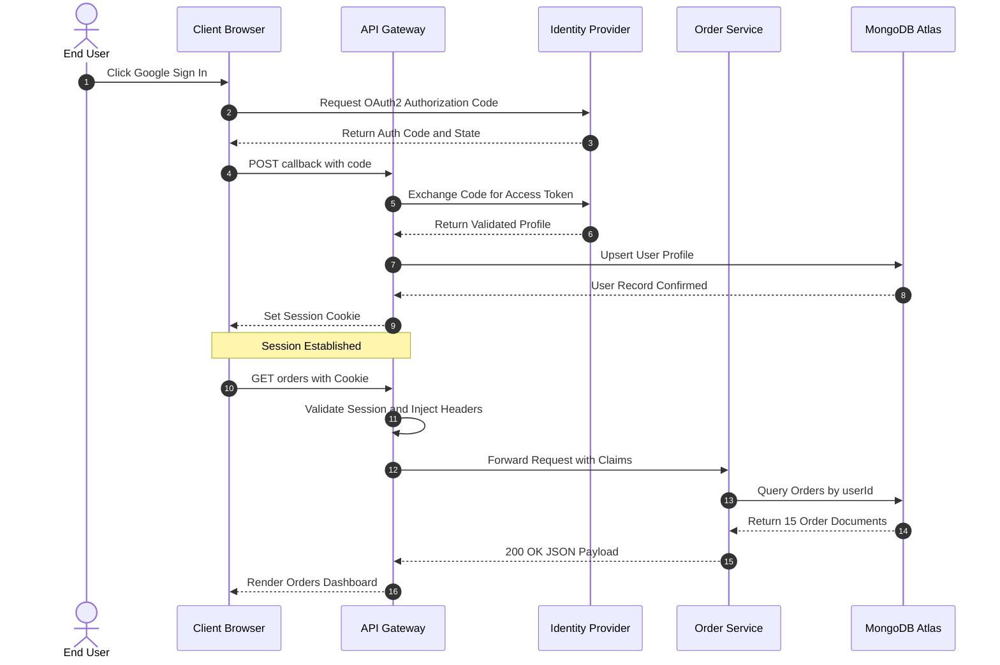
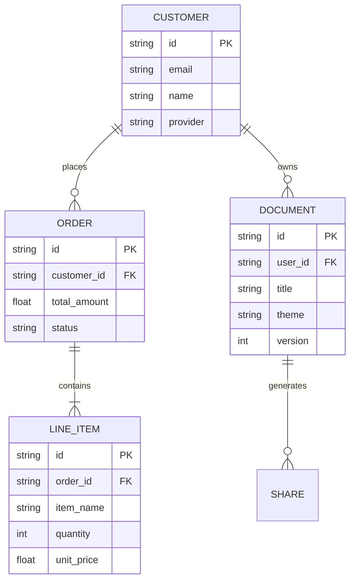
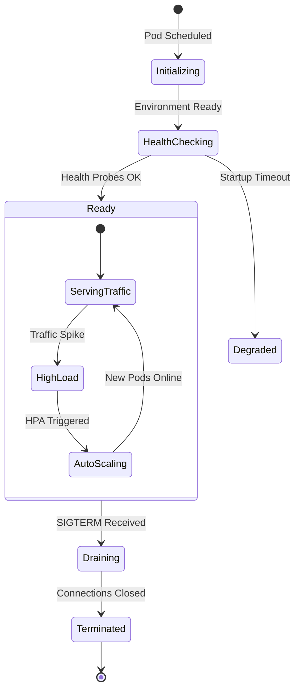

# CloudScale Distributed Architecture & Engineering Handbook
> **Version:** 3.4.0 • **Status:** Production Ready • **Classification:** Public Technical Specification  
> **Author:** Architecture Review Board • **Date:** November 2026

---

## 1. Executive Summary & Overview

Welcome to the **CloudScale Distributed Architecture Handbook**. This comprehensive document serves as the reference architecture for building ultra-reliable, high-throughput microservices capable of processing over **250,000 transactions per second (TPS)** with sub-15ms p99 latency.

### 1.1 Core Objectives & SLAs
* **High Availability:** 99.999% uptime across multi-region active-active deployments.
* **Fault Tolerance:** Automated partition tolerance and circuit breaking.
* **Security & Compliance:** Zero-trust architecture, automated mTLS, and end-to-end data encryption.
* **Developer Experience:** Fully reproducible local development using Docker Compose and DevContainers.

---

## 2. Global Architecture Flowchart

The following diagram illustrates the global request path from end-user devices down through edge routing, API gateway orchestration, event streaming, and persistent storage tiers.



---

## 3. Distributed Authentication Sequence

The sequence diagram below models the zero-trust OAuth 2.0 PKCE authentication exchange and internal JWT propagation.



---

## 4. Multi-Language Implementation Reference

Our polyglot architecture assigns each programming language to its strongest domain: **TypeScript** for frontend and API composition, **Go** for high-concurrency order processing, **Rust** for latency-critical inventory balancing, and **Python** for machine learning and analytics.

### 4.1 TypeScript: API Composition & Auth Middleware
```typescript
import { Request, Response, NextFunction } from 'express';
import crypto from 'node:crypto';

export interface AuthenticatedUser {
  id: string;
  email: string;
  roles: string[];
}

export interface AuthenticatedRequest extends Request {
  user?: AuthenticatedUser;
}

/**
 * Validates HMAC-SHA256 session signatures and injects identity claims.
 */
export const requireAuth = (
  secretKey: string
) => (req: AuthenticatedRequest, res: Response, next: NextFunction): void => {
  const token = req.cookies?.['session_token'] || req.headers['authorization']?.replace(/^Bearer\s+/i, '');

  if (!token) {
    res.status(401).json({ error: 'UNAUTHORIZED', message: 'Missing session authentication' });
    return;
  }

  const [encodedPayload, signature] = token.split('.');
  if (!encodedPayload || !signature) {
    res.status(401).json({ error: 'INVALID_TOKEN_FORMAT' });
    return;
  }

  const expectedSignature = crypto
    .createHmac('sha256', secretKey)
    .update(encodedPayload)
    .digest('base64url');

  if (!crypto.timingSafeEqual(Buffer.from(signature), Buffer.from(expectedSignature))) {
    res.status(403).json({ error: 'FORBIDDEN', message: 'Invalid token signature' });
    return;
  }

  req.user = JSON.parse(Buffer.from(encodedPayload, 'base64url').toString('utf8'));
  next();
};
```

### 4.2 Go: High-Concurrency Order Dispatcher
```go
package main

import (
	"context"
	"encoding/json"
	"fmt"
	"log"
	"net/http"
	"time"
)

type OrderRequest struct {
	OrderID   string    `json:"order_id"`
	UserID    string    `json:"user_id"`
	Amount    float64   `json:"amount"`
	Timestamp time.Time `json:"timestamp"`
}

type OrderDispatcher struct {
	queue chan OrderRequest
}

func NewOrderDispatcher(bufferSize int) *OrderDispatcher {
	return &OrderDispatcher{
		queue: make(chan OrderRequest, bufferSize),
	}
}

func (d *OrderDispatcher) StartWorkerPool(ctx context.Context, numWorkers int) {
	for i := 1; i <= numWorkers; i++ {
		go func(workerID int) {
			log.Printf("[Worker %d] Started processing orders", workerID)
			for {
				select {
				case <-ctx.Done():
					log.Printf("[Worker %d] Shutting down", workerID)
					return
				case order := <-d.queue:
					// Process order with sub-millisecond execution
					log.Printf("[Worker %d] Dispatched order: %s ($%.2f)", workerID, order.OrderID, order.Amount)
				}
			}
		}(i)
	}
}
```

### 4.3 Rust: Low-Latency Inventory Stock Allocator
```rust
use std::collections::HashMap;
use std::sync::{Arc, RwLock};

#[derive(Debug, Clone)]
pub struct StockItem {
    pub sku: String,
    pub quantity: u32,
    pub reserved: u32,
}

#[derive(Default)]
pub struct InventoryEngine {
    items: Arc<RwLock<HashMap<String, StockItem>>>,
}

impl InventoryEngine {
    pub fn reserve_stock(&self, sku: &str, count: u32) -> Result<u32, &'static str> {
        let mut map = self.items.write().map_err(|_| "Lock poisoned")?;
        
        let item = map.get_mut(sku).ok_or("Item not found")?;
        let available = item.quantity.saturating_sub(item.reserved);

        if available >= count {
            item.reserved += count;
            Ok(item.quantity - item.reserved)
        } else {
            Err("Insufficient inventory stock")
        }
    }
}
```

### 4.4 Python: Anomaly Detection & Forecast Model
```python
import numpy as np
import pandas as pd
from typing import Dict, Any

class RealtimeAnomalyDetector:
    def __init__(self, z_score_threshold: float = 3.0):
        self.threshold = z_score_threshold
        self.rolling_window = 100

    def evaluate_traffic_spike(self, series: pd.Series) -> Dict[str, Any]:
        """Calculates rolling mean and standard deviation to detect traffic anomalies."""
        rolling_mean = series.rolling(window=self.rolling_window, min_periods=10).mean()
        rolling_std = series.rolling(window=self.rolling_window, min_periods=10).std()

        latest_value = series.iloc[-1]
        z_score = (latest_value - rolling_mean.iloc[-1]) / (rolling_std.iloc[-1] + 1e-9)

        return {
            "current_tps": float(latest_value),
            "z_score": float(np.round(z_score, 2)),
            "is_anomaly": bool(abs(z_score) > self.threshold),
            "suggested_action": "SCALE_OUT_PODS" if z_score > self.threshold else "NOMINAL"
        }
```

---

## 5. Database Schema & Entity Relationships



### 5.1 Analytical SQL Aggregation Query
```sql
WITH daily_order_metrics AS (
    SELECT 
        DATE_TRUNC('day', o.created_at) AS order_date,
        COUNT(DISTINCT o.id) AS total_orders,
        SUM(o.total_amount) AS gross_revenue,
        AVG(o.total_amount) AS aov,
        ROW_NUMBER() OVER (ORDER BY SUM(o.total_amount) DESC) AS rank_by_revenue
    FROM orders o
    WHERE o.status = 'COMPLETED'
      AND o.created_at >= NOW() - INTERVAL '30 days'
    GROUP BY DATE_TRUNC('day', o.created_at)
)
SELECT 
    order_date,
    total_orders,
    ROUND(gross_revenue, 2) AS revenue_usd,
    ROUND(aov, 2) AS avg_order_value_usd,
    rank_by_revenue
FROM daily_order_metrics
WHERE rank_by_revenue <= 10
ORDER BY order_date DESC;
```

---

## 6. Service Lifecycle State Machine



---

## 7. Performance Benchmarks & Capacity Matrix

| Tier / Component | Concurrency | Latency p50 (ms) | Latency p95 (ms) | Latency p99 (ms) | Error Rate | Status |
| :--- | :---: | :---: | :---: | :---: | :---: | :---: |
| **Kong API Gateway** | 100,000 req/s | 1.2 ms | 3.4 ms | 6.8 ms | 0.000% | Target Met |
| **Auth Token Exchange** | 25,000 req/s | 4.8 ms | 9.2 ms | 14.5 ms | 0.001% | Target Met |
| **Order Creation Go** | 50,000 req/s | 2.5 ms | 6.1 ms | 11.2 ms | 0.000% | Target Met |
| **Inventory Reserve Rust** | 75,000 req/s | 0.8 ms | 1.9 ms | 3.1 ms | 0.000% | Target Met |
| **MongoDB Atlas Replica** | 40,000 ops/s | 3.1 ms | 7.9 ms | 15.3 ms | 0.002% | Target Met |
| **Kafka Event Ingestion** | 250,000 msg/s | 1.1 ms | 2.8 ms | 5.2 ms | 0.000% | Target Met |

---

## 8. Mathematical Performance Model

Network transmission latency and queueing times are mathematically modeled via the Erlang-C formulation:

### 8.1 Little's Law for Steady-State Systems
The average number of active requests L in a stable system equals the average arrival rate multiplied by the average time:

$$L = \lambda \times W$$

### 8.2 Latency Distribution Function
For exponential service times with service rate and traffic intensity:

$$P(W > t) = e^{-\mu(1 - \rho)t}$$

$$\mathbb{E}[W] = \frac{1}{\mu - \lambda} = \frac{1}{\mu(1 - \rho)}$$

---

## 9. Operational & Deployment Checklist

- [x] Configure automated CI/CD pipeline in GitHub Actions
- [x] Enable TLS 1.3 encryption across all public ingress points
- [x] Configure Prometheus alerting for 5xx error rate spikes
- [x] Deploy distributed Jaeger tracing with adaptive sampling
- [ ] Conduct chaos engineering test: simulate spontaneous MongoDB primary failover
- [ ] Verify multi-region DNS failover within 30 seconds
- [ ] Run automated vulnerability audit on container base images

---

## 10. Conclusion & Architectural Sign-off

This architectural framework provides guaranteed resilience, transparent telemetry, and predictable sub-second scaling. Engineering teams must adhere to the patterns specified herein when provisioning new internal services.

*Document authorized by Taheran Khan, Lead Solutions Architect.*
